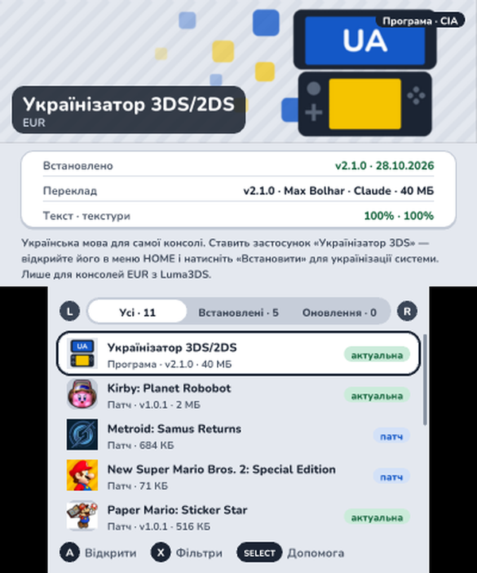
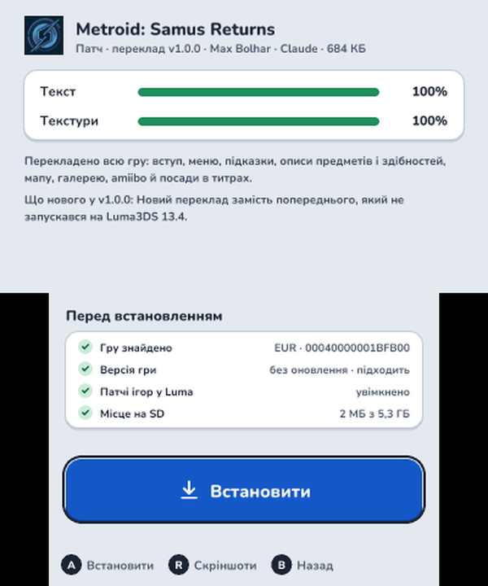
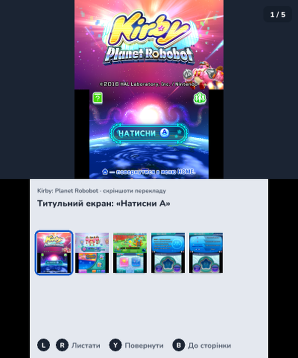
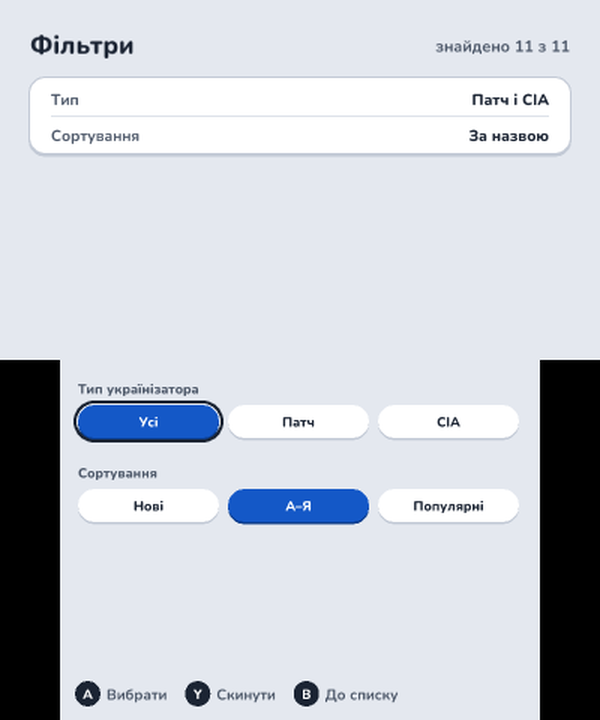
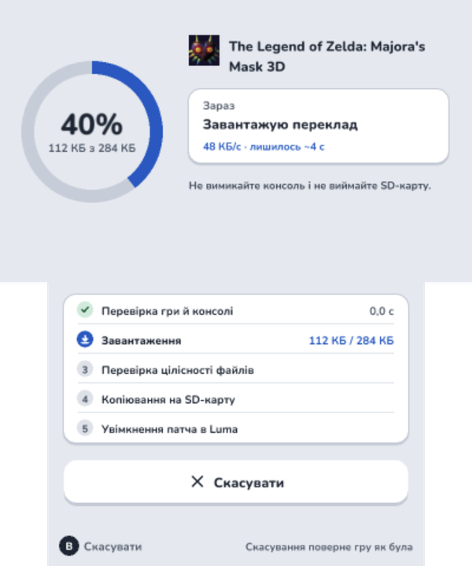
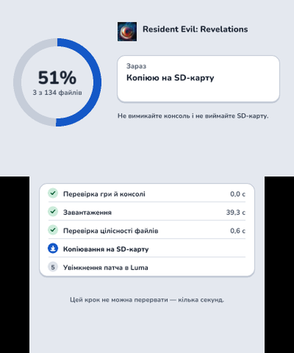
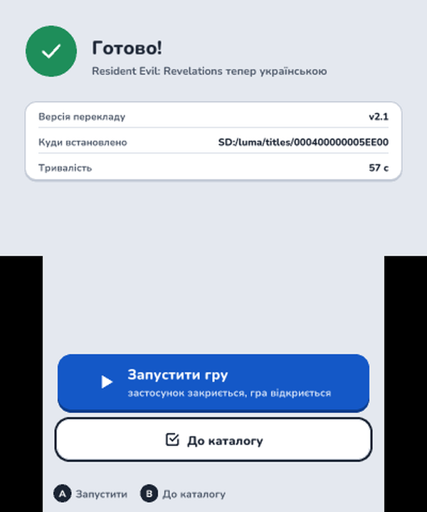
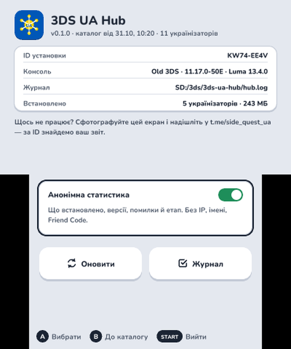

# 3DS UA Hub 🇺🇦

**Українізатори ігор для Nintendo 3DS в одному застосунку.** Каталог перекладів, встановлення одним натиском, оновлення й видалення. Застосунок сам знаходить гру на консолі, вибирає варіант перекладу під її регіон, ставить файли й вмикає потрібне в Luma.

Два види перекладів:

- **Патч** — файли перекладу на SD-карті (`luma/titles/<Title ID>/`), гра лишається вашою. Потрібна гра на консолі: встановлена або на картриджі.
- **Окрема гра (CIA)** — українська версія ставиться як нова програма в меню HOME, поруч з оригіналом. Тільки для ігор, які можна поширювати. Порт, що читає гру з SD-карти (як рушій butterscotch), отримує ще й теку з файлами гри: застосунок качає її після програми й розпаковує в `SD:/3ds/…`.

Ідея й рішення: [IDEA.md](IDEA.md). Дизайн усіх екранів: [артефакт](https://claude.ai/artifact/FE7cw2U38XgMqKk3mu7ftn).

## Як це виглядає

Скріншоти з консолі (Old 3DS).

<table>
  <tr>
    <td align="center" width="25%"><br><sub>Каталог: українізатор системи завжди першим, видно встановлене й оновлення</sub></td>
    <td align="center" width="25%"><br><sub>Сторінка перекладу: що перекладено й перевірки перед встановленням</sub></td>
    <td align="center" width="25%"><br><sub>Скріншоти перекладу в грі: L/R гортають, Y повертає</sub></td>
    <td align="center" width="25%"><br><sub>Фільтри: патчі чи окремі програми, сортування</sub></td>
  </tr>
  <tr>
    <td align="center"><br><sub>Встановлення крок за кроком, з докачкою й скасуванням</sub></td>
    <td align="center"><br><sub>Копіювання на SD-карту: файл за файлом</sub></td>
    <td align="center"><br><sub>Готово: гру можна одразу запустити</sub></td>
    <td align="center"><br><sub>Допомога: ID установки, консоль, журнал, статистика</sub></td>
  </tr>
</table>

## Що потрібно

- будь-яка Nintendo 3DS / 2DS / New 3DS / New 2DS XL з **Luma3DS v8.0 або новішою** (для патчів; CIA ставляться й так)
- Wi-Fi для каталогу. Без мережі каталог відкривається з копії на SD-карті
- місце на SD-карті під переклад

Немає Luma3DS? Спершу пройдіть [3ds.hacks.guide](https://3ds.hacks.guide/).

## Встановлення

Візьміть `3ds-ua-hub-<версія>.cia` з Releases, скопіюйте на SD-карту й встановіть через FBI. Після публікації в Universal-DB — через [Universal-Updater](https://github.com/Universal-Team/Universal-Updater), пошук «3DS UA Hub».

Програму з каталогу вже поставили самі, через FBI чи Universal-Updater? Якщо її версія збігається з каталогом, застосунок покаже її встановленою, і її можна оновлювати й видаляти звідси.

## Як користуватися

1. Відкрийте **3DS UA Hub** у меню HOME. Вкладки: **Усі**, **Встановлені**, **Оновлення** (`L`/`R`), фільтри — `X`, допомога — `SELECT`. Українізатор самої системи завжди стоїть першим.
2. Відкрийте переклад. Під «Перед встановленням» видно, чи знайдено гру, чи підходить її версія, Luma й місце на карті. `R` — скріншоти перекладу в грі, якщо вони є: `L`/`R` гортають, `Y` повертає скріншот, щоб роздивитися його, тримаючи консоль боком.
3. **Встановити**. Якщо в Luma вимкнені патчі ігор, застосунок увімкне їх сам і запропонує перезавантажити консоль.
4. **Запустити гру** — прямо з екрана «Готово».

На консолі кілька версій гри різних регіонів, і жодна не регіону консолі? Кнопка стане **Вибрати гру**: виберіть, яку перекладати. Змінити вибір — `Y` на сторінці перекладу.

Гру не знайдено? **Знайти гру** пропонує:

- **Шукати знову** — коли вставили картридж.
- **Завантажити гру** — якщо для перекладу в каталозі є гра: застосунок спершу перевірить посилання, завантажить гру (з докачкою), поставить її в меню HOME, а потім переклад.
- **Встановити без гри** — переклад ляже на SD-карту й чекатиме: вставте картридж чи встановіть гру пізніше, і Luma підхопить переклад сама. У каталозі такий переклад позначено «чекає гру».
- **Вибрати гру вручну** — якщо гру встановлено з іншим Title ID: застосунок звірить файли гри з перекладом ще до встановлення і скаже, чи підходить. Та сама гра, але файли не збіглися (інша версія чи регіон) — можна поставити на свій ризик. Зовсім іншу гру застосунок не дасть вибрати.

Усе керування — з D-pad і кнопок, стилус не обов'язковий.

## Як видалити переклад

Сторінка перекладу → **Видалити** (або `X`), далі на екрані підтвердження утримуйте `X` 2 с. Файли перекладу зникають; якщо в теці гри був чужий мод, застосунок відклав його при встановленні й тепер повертає на місце. Гра й збереження не зачіпаються. Гру, яку Hub завантажив разом з перекладом, можна прибрати тут же: на екрані видалення `Y` — «і гру» (разом з її збереженнями). Окрема гра (CIA) видаляється разом зі своїми збереженнями — застосунок попереджає. У порту з файлами на SD-карті зникають лише файли, які поставив застосунок: збереження в теці гри лишаються, і при оновленні теж переходять у нову версію.

## Надійність

- Кожен файл звіряється з підписаним каталогом (Ed25519 + sha256): підмінений чи пошкоджений файл не встановиться.
- Оновлення заміняє теку перекладу цілком, у два перейменування: гра бачить або старий набір, або новий.
- Вимкнулось живлення посеред встановлення — при наступному запуску застосунок доведе справу до кінця або поверне все як було й скаже про це.
- Обірвався Wi-Fi — завантаження продовжиться з того самого місця.

## Анонімна статистика

Після встановлення, оновлення, видалення чи помилки застосунок надсилає короткий звіт: що встановлено, версії, модель консолі, версії системи й Luma, код і етап помилки. Без IP, імені, Friend Code. Вимикається на екрані «Допомога». Там само — **ID установки**: назвіть його, коли пишете про проблему, і ми знайдемо ваш звіт.

## Якщо щось пішло не так

Журнал усіх дій — **Допомога → Журнал** або файл `SD:/3ds/3ds-ua-hub/hub.log`. На екрані помилки `Y` показує **деталі для звіту**: код системи, файл, версії, ID установки.

Обірвався Wi-Fi посеред завантаження — **Продовжити** докачає з того самого місця, **Скасувати встановлення** прибере завантажене.

---

## Для розробників

```
worker/   Cloudflare Worker: каталог з D1 (підписаний), файли з R2, статистика
app/      застосунок 3DS (C, devkitARM, citro2d)
docs/     FILLING.md — як додати переклад; DEPLOY.md — розгортання Worker
tools/    генерація іконки й банера
```

### Збірка

Потрібні Docker (образ `devkitpro/devkitarm`), Python 3 і `makerom`/`bannertool` (шляхи — у `Makefile`, `MAKEROM=`, `BANNERTOOL=`).

Заставку CIA (синя хвиля з написом «3DS UA Hub» замість «homebrew») `make cia` збирає сам: `tools/logo.py` перепідписує її ключем HOME Menu, який бере з дампу коду HOME Menu вашої консолі (`HOME_MENU_CODE=` у `Makefile`). Без дампу CIA лишається зі стандартною заставкою makerom.

```sh
make venv fonts art   # один раз: шрифти Nunito з кирилицею, іконка, банер
make app              # app/3ds-ua-hub.3dsx
make cia              # build/3ds-ua-hub-<версія>.cia
make test             # тести ядра на комп'ютері: каталог, вибір варіанта, встановлення з обривами живлення…
cd worker && npm test # тести Worker
```

Версія застосунку — `VERSION` у кореневому `Makefile`.

### Перевірка на емуляторі з локальним каталогом

`HUB_URL` і ключ каталогу перевизначаються при збірці, тож застосунок можна прогнати проти `wrangler dev` з тестовими даними:

```sh
docker run --rm -v "$PWD:/w" -w /w devkitpro/devkitarm make -C app \
  'EXTRA_CFLAGS=-DHUB_URL=\"http://127.0.0.1:8787\" -DCATALOG_KEY_BYTES=0x01,0xde,…'
```

Після такої збірки очистіть об'єктні файли й перезберіть звичайну — сам `make app` вважає їх актуальними й лишить у релізі локальну адресу:

```sh
docker run --rm -v "$PWD:/w" -w /w devkitpro/devkitarm make -C app clean && make app
``` В Azahar застосунок розпізнає емулятор і не вимагає Luma.

### Реліз

1. Підніміть `VERSION` у `Makefile`, `make test`, `make cia`.
2. Створіть реліз на GitHub з `build/3ds-ua-hub-<версія>.cia` і `app/3ds-ua-hub.3dsx`.
3. Universal-DB: подайте застосунок у [Universal-Team/db](https://github.com/Universal-Team/db) (опис, іконка, посилання на репозиторій з релізами). Наступні релізи Universal-DB підхоплює з GitHub Releases.

Новий формат каталогу, якого старі застосунки не розуміють, — це новий `CATALOG_VERSION` і новий реліз. Додайте в корінь каталогу `"app": "<мінімальна версія застосунку>"`: старі версії покажуть «Оновіть 3DS UA Hub · Потрібна v…» і дадуть переглянути встановлене з останнього каталогу, який розуміють.
